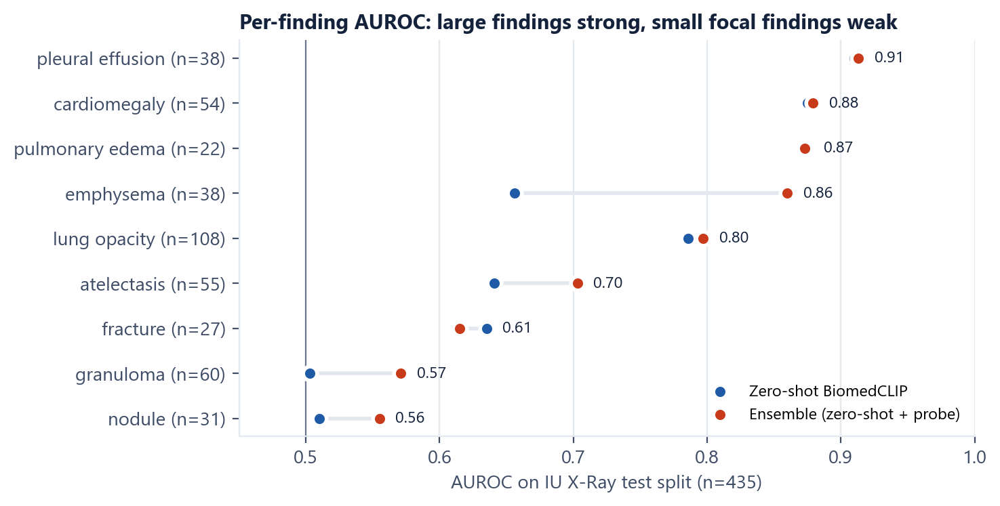
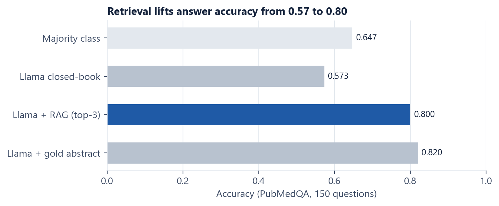
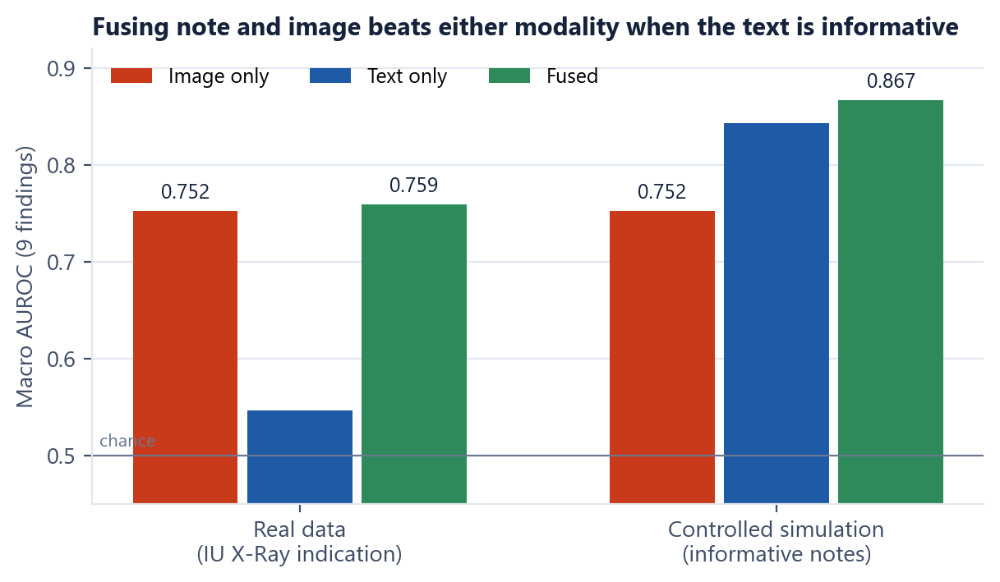
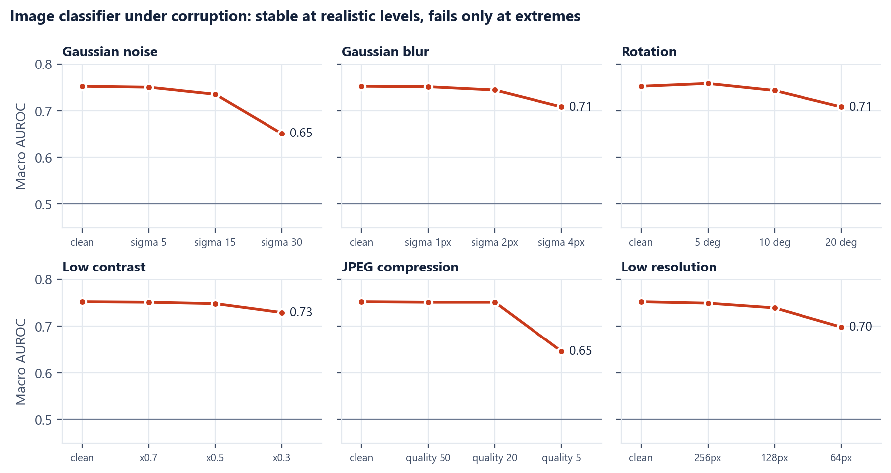
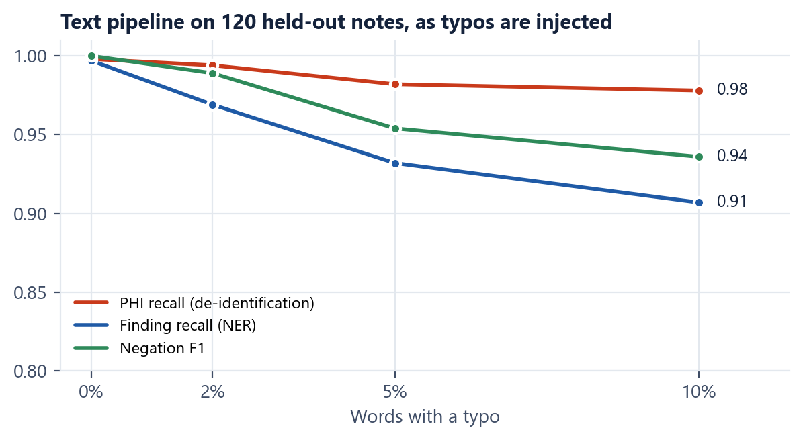

# MedAssist: evaluation results

_Generated by `python -m scripts.report.make_report` from `results/*.json`. Do not edit by hand._

## 1. Image findings (IU X-Ray, test n=435, 9 findings)

| Variant | Macro AUROC | Macro F1 | Abnormal vs normal AUROC |
|---|---|---|---|
| zero-shot | 0.71 | 0.327 | 0.692 |
| zero-shot + CLAHE | 0.704 | 0.307 | 0.696 |
| linear probe | 0.728 | 0.349 | 0.754 |
| ensemble (ZS+probe) | 0.752 | 0.363 | 0.773 |

Calibration of the ensemble (test): ECE 0.1087 -> **0.0223**, Brier 0.1135 -> 0.0812 after Platt scaling.

## 2. Similar-case retrieval

| Route | P@1 | P@5 | P@10 |
|---|---|---|---|
| image->report | 0.382 | 0.406 | 0.414 |
| image->image | 0.492 | 0.44 | 0.429 |
| random | 0.278 | 0.278 | 0.278 |

## 3. Text: PubMedQA

| Embedder | R@1 | R@3 | R@10 |
|---|---|---|---|
| BioBERT (S-T, NLI/STS) | 0.899 | 0.959 | 0.986 |
| ClinicalBERT (mean-pooled) | 0.159 | 0.251 | 0.373 |
| PubMedBERT (MS-MARCO) | 0.975 | 0.989 | 0.994 |
| MiniLM (general domain) | 0.971 | 0.989 | 0.997 |

| QA mode | Accuracy | Macro F1 |
|---|---|---|
| closed-book | 0.573 | 0.361 |
| RAG (top-3) | 0.8 | 0.546 |
| oracle context | 0.82 | 0.562 |
| majority-class baseline | 0.647 | 0.262 |

## 4. Multimodal fusion vs unimodal (macro AUROC)

| Setting | Image only | Text only | Fused | Fused - image, 95% CI |
|---|---|---|---|---|
| A. Real indication text | 0.752 | 0.546 | 0.759 | +0.001 to +0.014 |
| B. Controlled simulation | 0.752 | 0.843 | 0.867 | +0.097 to +0.133 |

Conflict detection on injected discordances: 29/61 overall; **100%** when the image classifier agrees with ground truth; alert rate without injection 17%.

LLM text-only baseline on indications: macro AUROC 0.552.

## 5. Robustness of the image classifier

Clean: macro AUROC 0.752, abnormal-vs-normal 0.773.

| Corruption | Severity | Macro AUROC | Change | Abnormal AUROC |
|---|---|---|---|---|
| gaussian noise | sigma 5 | 0.75 | -0.002 | 0.772 |
| gaussian noise | sigma 15 | 0.735 | -0.017 | 0.709 |
| gaussian noise | sigma 30 | 0.651 | -0.101 | 0.615 |
| gaussian blur | sigma 1px | 0.751 | -0.001 | 0.758 |
| gaussian blur | sigma 2px | 0.744 | -0.008 | 0.737 |
| gaussian blur | sigma 4px | 0.708 | -0.044 | 0.698 |
| rotation | 5 deg | 0.758 | +0.006 | 0.783 |
| rotation | 10 deg | 0.743 | -0.009 | 0.789 |
| rotation | 20 deg | 0.708 | -0.044 | 0.641 |
| low contrast | x0.7 | 0.751 | -0.001 | 0.758 |
| low contrast | x0.5 | 0.748 | -0.004 | 0.738 |
| low contrast | x0.3 | 0.729 | -0.023 | 0.701 |
| jpeg | quality 50 | 0.751 | -0.001 | 0.773 |
| jpeg | quality 20 | 0.751 | -0.001 | 0.747 |
| jpeg | quality 5 | 0.646 | -0.106 | 0.65 |
| low resolution | 256px | 0.749 | -0.003 | 0.751 |
| low resolution | 128px | 0.739 | -0.013 | 0.723 |
| low resolution | 64px | 0.698 | -0.054 | 0.704 |

## 6. Text pipeline on held-out notes

120 generated notes (seed 2027), never used for tuning.

| PHI type | n | Recall |
|---|---|---|
| date | 240 | 1.0 |
| email | 55 | 1.0 |
| facility | 120 | 1.0 |
| id | 120 | 1.0 |
| location | 57 | 1.0 |
| name | 240 | 0.992 |
| phone | 74 | 1.0 |

| Typos | PHI recall | Token leak | Clinical text kept | Finding recall | Negation F1 |
|---|---|---|---|---|---|
| 0% | 0.998 | 0.021 | 0.999 | 0.997 | 1.0 |
| 2% | 0.994 | 0.03 | 0.996 | 0.969 | 0.989 |
| 5% | 0.982 | 0.038 | 0.989 | 0.932 | 0.954 |
| 10% | 0.978 | 0.051 | 0.982 | 0.907 | 0.936 |

Before the facility-name fix, the discovery set (seed 2026) showed hospital names removed 0% of the time and overall PHI recall 0.862; the numbers above are from a fresh set generated after the fix.

## 7. Answer faithfulness and latency (real Llama, 7 demo cases x 4 questions)

| Metric | Value |
|---|---|
| Answers | 28 |
| Routing accuracy | 1.0 |
| Format compliance | 1.0 |
| Citation coverage (claims with a citation) | 0.503 |
| Citation validity (cited ids that exist) | 0.978 |
| Ungrounded number rate | 0.004 |
| Triage level stated (triage questions) | 1.0 |
| Triage contradictions | 0 |
| Conflict disclosure (cases with HIGH/MEDIUM conflict) | 0.917 |
| Answers with unsafe certainty phrases | 0 |
| Median answer length (words) | 155.5 |
| Median evidence stage latency (s) | 0.07 |
| Median LLM latency (s) | 15.8 |

## 8. Usability study

Not run yet: follow `docs/user_study/protocol.md`, then `python -m scripts.evaluate.user_study` and rerun this report.
